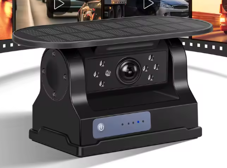

<div align="center">

# WCam

**Lightweight native Android & Android Auto viewer for solar Wi-Fi backup cameras**  
*Solar Wi-Fi geri görüş kameraları için hafif yerel Android ve Android Auto görüntüleyicisi*

[English](#english) · [Türkçe](#türkçe)

<br />



*Supported magnetic solar Wi-Fi backup camera (`192.168.10.1` · `1280x720`)*  
*Desteklenen manyetik solar Wi-Fi geri görüş kamerası (`192.168.10.1` · `1280x720`)*

</div>

---

## English

### Overview

**WCam** is a lightweight (~3.4 MB release APK) native Kotlin Android application built for E-Eye / `XMLink` compatible Wi-Fi backup cameras (`192.168.10.1`, `1280x720`, `arm64-v8a`). It replaces heavy cross-platform wrappers with direct OpenGL ES 2.0 video rendering, instant local Wi-Fi socket binding, floating overlay support, and **Android Auto** head-unit projection.

### Features

- **Live `1280x720` Streaming & OpenGL ES 2.0 Rendering**: Low-latency hardware-accelerated I420 (YUV420P) playback with automatic aspect-ratio fitting.
- **Fullscreen & Floating Overlay Modes**: Immersive fullscreen phone view plus a draggable and resizable floating window (`SYSTEM_ALERT_WINDOW`) over navigation or other apps, with seamless switching controlled strictly by the user without dropping the stream or an active recording.
- **Android Auto Support**: Built with Jetpack `androidx.car.app` Projected (`NavigationTemplate` + `SurfaceCallback`) to display live rear camera video and OpenGL parking guide lines directly on the vehicle's infotainment screen, with action-strip controls (**Lines**, **Record/Stop**, **Photo**, **Mirror**, **Connect**).
- **Toggleable & Calibratable Parking Guide Lines**: 3-zone perspective rear guidelines (Green / Yellow / Red) that can be toggled on/off anytime and calibrated on the phone screen by dragging the 4 trapezoid corners (saved persistently and mirrored to Android Auto in real time).
- **Video Recording & Snapshots**: Capture MP4 videos saved to `Movies/WCam` and JPG snapshots saved to `Pictures/WCam` via MediaStore.
- **Horizontal Mirror Toggle**: Uses camera hardware mirroring when supported by firmware, with automatic OpenGL fallback.
- **Reliable Camera Wi-Fi Binding**: Uses `ConnectivityManager.bindProcessToNetwork` so traffic to `192.168.10.1` routes over the camera's no-internet Wi-Fi AP even when mobile data is active, plus an in-app Wi-Fi connection dialog and automatic reconnection.
- **Multi-Language Support (English & Turkish)**: Follows the system language automatically, integrates with Android 13+ **App Languages** settings, and includes an in-app **EN / TR** quick switcher (`System Default`, `Türkçe`, `English`).

### Requirements

- **Android**: 7.0+ (`minSdk 24`, `targetSdk 35`)
- **ABI**: `arm64-v8a`
- **Build Tools**: JDK 17 & Android Gradle Plugin

### Build & Install

```bash
git clone https://github.com/nakturk/wcam.git
cd wcam

# Run unit tests
./gradlew testDebugUnitTest

# Build release APK (output: app/build/outputs/apk/release/app-release.apk)
./gradlew assembleRelease

# Build and install release APK onto a USB-connected phone
./gradlew installRelease
```

### How to Use

#### 1. On Your Phone (Fullscreen & Floating Overlay)

1. Power on the backup camera and wait for its Wi-Fi hotspot (for example `backcam_...`) to become available.
2. Connect your phone to the camera's Wi-Fi network from Android Wi-Fi settings, or tap **Wi-Fi** inside WCam to enter the SSID/password and bind directly.
3. Live `1280x720` video appears automatically once connected.
4. Tap anywhere on the video to show or hide the HUD controls:
   - **Lines**: Toggle the 3-zone rear parking guide lines on/off.
   - **Calibrate**: Enter corner-drag mode to adjust the parking trapezoid to your vehicle, then tap **Done** (or **Reset** to restore defaults).
   - **Record**: Start or stop MP4 video recording (timer badge stays visible while recording; files are saved under `Movies/WCam`).
   - **Photo**: Save a JPG snapshot under `Pictures/WCam`.
   - **Mirror**: Flip the camera view horizontally.
   - **Overlay**: Minimize WCam into a draggable, resizable floating window over other apps (requires "Display over other apps" permission).
   - **EN / TR**: Switch language between **System Default**, **Türkçe**, and **English**.

#### 2. On Android Auto

> **Important (USB vs. Wireless Android Auto):** Because your phone's Wi-Fi radio must stay connected to the backup camera's Wi-Fi hotspot (`192.168.10.1`), connect your phone to the car head unit via a **USB cable** when using WCam with Android Auto.

**One-time Android Auto setup for sideloaded APKs:**

1. Open **Settings → Android Auto** on your phone.
2. Scroll to the bottom and tap **Version** **10 times** to enable Developer Mode, then confirm the prompt.
3. Open the top-right **⋮** menu → **Developer settings** and enable **Unknown sources**.

**In the car:**

1. Plug your phone into the car via **USB** to start Android Auto.
2. Connect your phone's Wi-Fi to the camera's Wi-Fi network (`backcam_...`).
3. Open **WCam** on your car's Android Auto screen.
4. Use the on-screen action buttons to toggle **Lines**, **Record/Stop**, **Photo**, **Mirror**, or tap **Connect** to retry immediately.

### Project Structure

| Component | Responsibility |
| --- | --- |
| `app/src/main/java/com/wcam/app/MainActivity.kt` | Fullscreen UI, HUD controls, corner calibration, Wi-Fi & language dialogs |
| `app/src/main/java/com/wcam/app/service/OverlayCameraService.kt` | Foreground service managing the draggable/resizable floating overlay window |
| `app/src/main/java/com/wcam/app/camera/CameraSessionManager.kt` | Shared camera lifecycle, reconnect loop, recording/snapshot & state controller |
| `app/src/main/java/com/wcam/app/net/WifiNetworkHelper.kt` | Process network binding to the camera Wi-Fi AP and AP connection helper |
| `app/src/main/java/com/wcam/app/gl/EglSurfaceRenderer.kt` | EGL10 driver supporting phone `SurfaceTexture` and Android Auto `Surface` |
| `app/src/main/java/com/wcam/app/gl/YuvGlRenderer.kt` | OpenGL ES 2.0 I420 shader renderer with optional 2D parking guide overlay pass |
| `app/src/main/java/com/wcam/app/gl/GlParkingLinesGeometry.kt` | Screen-space NDC triangle tessellation for Android Auto parking guide lines |
| `app/src/main/java/com/wcam/app/auto/WCamCarAppService.kt` | Android Auto `CarAppService` & host validator |
| `app/src/main/java/com/wcam/app/auto/WCamCarSession.kt` | Android Auto `Session` entry point |
| `app/src/main/java/com/wcam/app/auto/WCamCameraScreen.kt` | Android Auto `NavigationTemplate` & `SurfaceCallback` live camera screen |
| `app/src/main/java/com/wcam/app/model/RulerConfig.kt` | Parking trapezoid model, bounds clamping & camera ruler protocol mapping |
| `app/src/main/java/com/wcam/app/ui/ParkingLinesView.kt` | Interactive Canvas parking lines & corner drag handles for phone UI |
| `app/src/main/java/com/wcam/app/util/AppLanguageManager.kt` | System / Türkçe / English language management (API 24–35) |
| `app/src/main/java/com/sw/driveeye/linkdevice/XMLinkDevice.java` | JNI wrapper for `libxmlinkdevice.so` (`arm64-v8a`) |

---

## Türkçe

### Genel Bakış

**WCam**, E-Eye / `XMLink` uyumlu Wi-Fi geri görüş kameraları (`192.168.10.1`, `1280x720`, `arm64-v8a`) için geliştirilmiş hafif (~3,4 MB release APK) ve tamamen yerel (native Kotlin) bir Android uygulamasıdır. Ağır çapraz platform katmanları yerine doğrudan OpenGL ES 2.0 video işleme, yerel Wi-Fi ağ bağlama, kayan pencere (Overlay) ve **Android Auto** desteği sunar.

### Özellikler

- **Canlı `1280x720` Akış ve OpenGL ES 2.0 Çizimi**: En-boy oranını koruyan düşük gecikmeli donanım hızlandırmalı I420 (YUV420P) görüntü işleme.
- **Tam Ekran ve Kayan Pencere (Overlay) Modları**: Telefon üzerinde tam ekran kullanım veya navigasyon/diğer uygulamaların üzerinde sürüklenip yeniden boyutlandırılabilen küçük overlay pencere (`SYSTEM_ALERT_WINDOW`). Modlar arası geçiş tamamen kullanıcı kontrolündedir; akış ve devam eden video kaydı kesilmez.
- **Android Auto Desteği**: Jetpack `androidx.car.app` Projected (`NavigationTemplate` + `SurfaceCallback`) altyapısı ile canlı arka kamera görüntüsünü ve park çizgilerini doğrudan aracın ekranına yansıtır; araç ekranından **Çizgi**, **Kayıt/Durdur**, **Foto**, **Ayna** ve **Bağlan** kontrolleri sunar.
- **Açılıp Kapatılabilir ve Kalibre Edilebilir Park Çizgileri**: Aracınıza göre 4 köşesi sürüklenerek kalibre edilebilen 3 bölgeli (Yeşil / Sarı / Kırmızı) perspektif park çizgileri. Ayarlar kalıcı olarak saklanır ve Android Auto ekranına da anlık yansır.
- **Video Kaydı ve Fotoğraf Çekimi**: MP4 video kayıtlarını `Movies/WCam`, JPG fotoğrafları `Pictures/WCam` klasörüne MediaStore üzerinden kaydeder.
- **Ayna (Yatay Çevirme) Desteği**: Kamera yazılımı desteklediğinde donanım üzerinden, aksi durumda OpenGL üzerinden yatay çevirme uygular.
- **Kararlı Kamera Wi-Fi Bağlantısı**: `ConnectivityManager.bindProcessToNetwork` kullanarak telefonun mobil verisi açıkken bile `192.168.10.1` trafiğini interneti olmayan kamera Wi-Fi ağına yönlendirir; uygulama içi Wi-Fi diyalogu ve otomatik yeniden bağlanma içerir.
- **Türkçe ve İngilizce Çoklu Dil Desteği**: Sistem dilini otomatik algılar, Android 13+ **Uygulama Dilleri** ayarını destekler ve üst çubuktaki **TR / EN** butonuyla anlık dil geçişi sağlar.

### Gereksinimler

- **Android**: 7.0 ve üzeri (`minSdk 24`, `targetSdk 35`)
- **Mimari (ABI)**: `arm64-v8a`
- **Derleme Araçları**: JDK 17 ve Android Gradle Plugin

### Derleme ve Kurulum

```bash
git clone https://github.com/nakturk/wcam.git
cd wcam

# Birim testlerini çalıştırın
./gradlew testDebugUnitTest

# Release APK üretin (çıktı: app/build/outputs/apk/release/app-release.apk)
./gradlew assembleRelease

# USB ile bağlı telefona doğrudan kurun
./gradlew installRelease
```

### Nasıl Kullanılır?

#### 1. Telefonda Kullanım (Tam Ekran ve Overlay)

1. Kamerayı açın ve kameranın Wi-Fi ağının (`backcam_...` vb.) yayın yapmasını bekleyin.
2. Telefonun Wi-Fi ayarlarından kamera ağına bağlanın veya WCam içindeki **Wi-Fi** butonundan SSID/şifre girerek bağlanın.
3. Bağlantı kurulduğunda `1280x720` canlı görüntü otomatik açılır.
4. Kontrolleri gizlemek veya göstermek için ekrana dokunun:
   - **Çizgi**: 3 bölgeli arka park kılavuz çizgilerini açıp kapatır.
   - **Ayarla**: Köşeleri sürükleyerek park çizgilerini aracınızın tampon ve genişliğine göre hizalar; **Tamam** ile kaydeder (**Sıfırla** varsayılana döndürür).
   - **Kayıt / Durdur**: MP4 video kaydı başlatır/durdurur (kayıt süresi rozeti üstte görünür, dosya `Movies/WCam` altına kaydedilir).
   - **Fotoğraf**: Anlık kareyi JPG olarak `Pictures/WCam` altına kaydeder.
   - **Ayna**: Görüntüyü yatay olarak çevirir.
   - **Overlay**: Uygulamayı diğer uygulamaların üzerinde duran sürüklenebilir/boyutlandırılabilir küçük pencereye alır ("Diğer uygulamaların üzerinde gösterme" izni gerektirir).
   - **TR / EN**: Uygulama dilini **Sistem Dili**, **Türkçe** veya **English** olarak değiştirir.

#### 2. Android Auto Üzerinde Kullanım

> **Önemli Not (USB ve Kablosuz Android Auto):** Telefonun Wi-Fi bağlantısı kameranın Wi-Fi ağına (`192.168.10.1`) bağlı kalmak zorunda olduğu için, Android Auto kullanırken telefonu araca **USB kablo** ile bağlamanız gerekir.

**Google Play dışından kurulan APK'lar için tek seferlik Android Auto ayarı:**

1. Telefonda **Ayarlar → Android Auto** menüsünü açın.
2. En alta inip **Sürüm** satırına art arda **10 kez** dokunarak geliştirici modunu açın ve onaylayın.
3. Sağ üstteki **⋮** menüsünden **Geliştirici ayarları** bölümüne girip **Bilinmeyen kaynaklar** seçeneğini işaretleyin.

**Araçta kullanım:**

1. Telefonu araca **USB kablo** ile bağlayıp Android Auto'yu başlatın.
2. Telefonun Wi-Fi bağlantısını kameranın `backcam_...` ağına bağlayın.
3. Araç ekranındaki Android Auto menüsünden **WCam** uygulamasını açın.
4. Araç ekranındaki kontrol çubuğundan **Çizgi**, **Kayıt/Durdur**, **Foto**, **Ayna** veya **Bağlan** butonlarını doğrudan kullanabilirsiniz.

### Proje Yapısı

| Bileşen | Görev |
| --- | --- |
| `app/src/main/java/com/wcam/app/MainActivity.kt` | Tam ekran arayüz, HUD kontrolleri, köşe kalibrasyonu, Wi-Fi ve dil diyalogları |
| `app/src/main/java/com/wcam/app/service/OverlayCameraService.kt` | Sürüklenip boyutlandırılabilen kayan pencere (Overlay) ön plan servisi |
| `app/src/main/java/com/wcam/app/camera/CameraSessionManager.kt` | Ortak kamera oturumu, otomatik yeniden bağlanma, kayıt ve durum yönetimi |
| `app/src/main/java/com/wcam/app/net/WifiNetworkHelper.kt` | Kamera Wi-Fi ağına süreç bazlı soket bağlama ve AP bağlantı yardımcısı |
| `app/src/main/java/com/wcam/app/gl/EglSurfaceRenderer.kt` | Telefon `SurfaceTexture` ve Android Auto `Surface` destekli EGL10 sürücüsü |
| `app/src/main/java/com/wcam/app/gl/YuvGlRenderer.kt` | OpenGL ES 2.0 I420 video işleyici ve opsiyonel park çizgisi shader katmanı |
| `app/src/main/java/com/wcam/app/gl/GlParkingLinesGeometry.kt` | Android Auto yüzeyi için NDC uzayında park çizgisi üçgen geometrisi |
| `app/src/main/java/com/wcam/app/auto/WCamCarAppService.kt` | Android Auto `CarAppService` ve host doğrulayıcı |
| `app/src/main/java/com/wcam/app/auto/WCamCarSession.kt` | Android Auto `Session` giriş noktası |
| `app/src/main/java/com/wcam/app/auto/WCamCameraScreen.kt` | Android Auto `NavigationTemplate` ve `SurfaceCallback` canlı kamera ekranı |
| `app/src/main/java/com/wcam/app/model/RulerConfig.kt` | Park çizgisi yamuğu veri modeli, sınır doğrulama ve kamera protokol dönüşümü |
| `app/src/main/java/com/wcam/app/ui/ParkingLinesView.kt` | Telefon arayüzü için etkileşimli Canvas park çizgileri ve köşe tutamaçları |
| `app/src/main/java/com/wcam/app/util/AppLanguageManager.kt` | Sistem / Türkçe / İngilizce dil yönetimi (API 24–35) |
| `app/src/main/java/com/sw/driveeye/linkdevice/XMLinkDevice.java` | `libxmlinkdevice.so` (`arm64-v8a`) JNI sarmalayıcısı |
